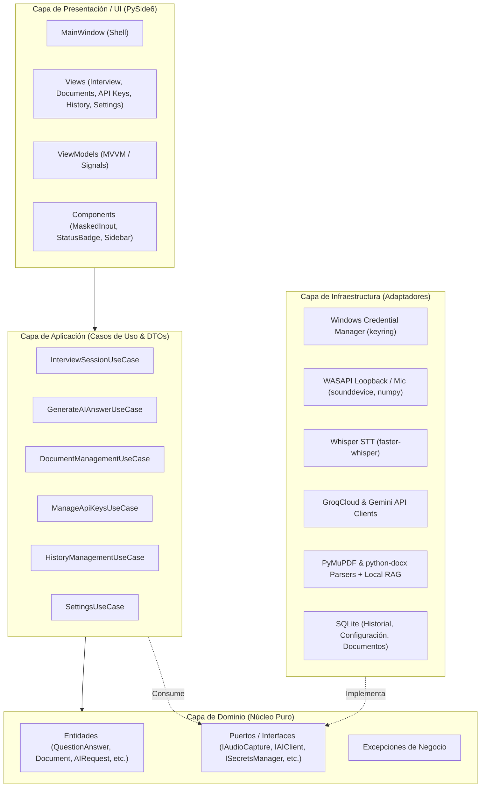
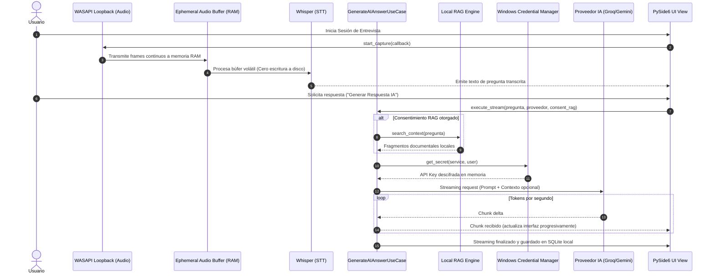

# Arquitectura de Software - Remodax

Remodax es una aplicación de escritorio moderna para Windows 10 y 11 diseñada bajo **Clean Architecture** (Arquitectura Limpia) y los principios **SOLID**. El objetivo primordial es el desacoplamiento estricto, la alta velocidad de respuesta mediante streaming, la privacidad documental y la protección cibernética de credenciales.

---

## 1. Diagrama de Capas de Clean Architecture

---

## 2. Aplicación de Principios SOLID

1. **S - Single Responsibility Principle (SRP):**
   - Cada servicio, caso de uso y vista tiene un único propósito. Por ejemplo, `WindowsCredentialManager` solo interactúa con el almacén seguro del sistema operativo; `LocalRAGEngine` solo calcula similitud textual para RAG; `SensitiveDataFilter` solo anonimiza claves en logs.
2. **O - Open/Closed Principle (OCP):**
   - Nuevos proveedores de IA (ej. OpenAI, Claude) o parsers de nuevos formatos (.txt, .md) pueden añadirse implementando `IAIClient` o `IDocumentParser` sin modificar la lógica existente ni los casos de uso.
3. **L - Liskov Substitution Principle (LSP):**
   - Tanto `GroqProvider` como `GeminiProvider` cumplen el contrato `IAIClient`. La fábrica `AIProviderFactory` puede intercambiarlos indistintamente.
4. **I - Interface Segregation Principle (ISP):**
   - Las interfaces están segregadas por capacidad: `IAudioCaptureService`, `IAudioTranscriber`, `IRAGService`, `ISecretsManager`, `IHistoryRepository`. Ninguna clase está obligada a depender de métodos que no utiliza.
5. **D - Dependency Inversion Principle (DIP):**
   - Los casos de uso dependen exclusivamente de abstracciones (Puertos en `src/domain/ports/`), no de implementaciones concretas. Todas las implementaciones se inyectan en el Composition Root (`src/container.py`).

---

## 3. Flujo de Datos en Tiempo Real (Entrevistas & IA)

---

## 4. Estructura de Módulos y Paquetes

- **`src/domain/`**:
  - `entities/`: Modelos puros (`interview.py`, `document.py`, `ai_models.py`, `settings_entity.py`).
  - `ports/`: Contratos de interfaces (`audio_port.py`, `ai_port.py`, `document_port.py`, `security_port.py`, `storage_port.py`).
  - `exceptions.py`: Errores tipados de dominio.
- **`src/application/`**:
  - `dtos/`: Objetos de transferencia desacoplados de la GUI.
  - `use_cases/`: Casos de uso de negocio (`interview_use_cases.py`, `ai_use_cases.py`, etc.).
- **`src/infrastructure/`**:
  - `security/`: Adaptador de Windows Credential Manager y utilidades de enmascaramiento.
  - `audio/`: Captura WASAPI y transcripción con Whisper.
  - `ai/`: Conectores para GroqCloud y Google Gemini con streaming.
  - `documents/`: Parsers de PyMuPDF y python-docx con motor RAG local.
  - `storage/`: Base de datos SQLite y repositorios locales.
- **`src/ui/`**:
  - `views/`: Vistas de PySide6 para cada módulo.
  - `view_models/`: ViewModels basados en `QObject` y `Signal` para manejo multihilo.
  - `components/`: Componentes reutilizables (Sidebar, MaskedInput, StatusBadge).
- **`src/config/`**: Constantes, rutas locales (`LOCALAPPDATA`) y filtro de registros sanitizados.
